<!-- ════════════════════ HEADER ════════════════════ -->
<p align="center">
  
</p>

<p align="center">
  
</p>

<p align="center">
  
  
  
</p>

---

## 🖥️ `~/lataksh $ whoami`

```bash
$ cat lataksh.json
```

```json
{
  "name": "Lataksh Sariya",
  "campus": "IIT Dharwad ⚡",
  "branch": "B.Tech, Electrical & Electronics Engineering",
  "currentRole": "SWE Intern @ Karnataka Incubation Foundation",
  "superpower": "Turning ideas into deployed products",
  "origin_story": "Started with circuits, got hooked on the web 🌐",
  "coffee_to_code_ratio": "dangerously high ☕",
  "status": "building something right now"
}
```

---

## 🏆 `git log --achievements`

```diff
+ commit a1f3c9e  [SHIPPED]     Deployed 3+ real-world projects for IIT Dharwad
+ commit b7d204a  [CLIENTS]     Delivered work for 2 freelance clients
+ commit c93e8f1  [INTERNSHIP]  SWE Intern at Karnataka Incubation Foundation
+ commit d5a6b72  [GRIND]       200+ problems solved on LeetCode
+ commit e08c4d3  [CS CORE]     OOPs · DSA · C/C++ locked in
```

<table align="center">
  <tr>
    <td align="center" width="25%">
      <h1>3+</h1>
      <b>Projects Deployed</b><br/>
      <sub>for IIT Dharwad</sub>
    </td>
    <td align="center" width="25%">
      <h1>2</h1>
      <b>Freelance Clients</b><br/>
      <sub>real work, real deadlines</sub>
    </td>
    <td align="center" width="25%">
      <h1>1</h1>
      <b>SWE Internship</b><br/>
      <sub>Karnataka Incubation Foundation</sub>
    </td>
    <td align="center" width="25%">
      <h1>200+</h1>
      <b>LeetCode Solved</b><br/>
      <sub>and still grinding</sub>
    </td>
  </tr>
</table>

---

## 🧠 Skill Tree

```text
 ┌─────────────────────────────────────────────────────────┐
 │  🎨 FRONTEND      ████████████████████░░   Advanced     │
 │  ⚙️  BACKEND       ██████████████░░░░░░░░   Leveling up  │
 │  🧮 DSA           ████████████████░░░░░░   200+ solved  │
 │  🏗️  OOPs          ██████████████████░░░░   Strong       │
 │  💻 C / C++       ████████████████░░░░░░   Solid        │
 └─────────────────────────────────────────────────────────┘
```

### 🎨 Frontend
<p>
  
</p>

### ⚙️ Backend
<p>
  
</p>

### 🧩 Core CS & Tools
<p>
  
</p>

> **Core CS:** `OOPs` · `Data Structures & Algorithms` · `C / C++` · `Problem Solving`

---

## 🗺️ The Journey

```mermaid
flowchart LR
    A([⚡ EEE at IIT Dharwad]) --> B([🌐 Discovered Web Dev])
    B --> C([🚀 Shipped 3+ Campus Projects])
    C --> D([💼 2 Freelance Clients])
    D --> E([🏢 SWE Intern @ KIF])
    E --> F([🎯 Full Stack + DSA Grind])
    F --> G([🔮 What's Next?])

    style A fill:#0d1117,stroke:#58a6ff,color:#fff
    style B fill:#0d1117,stroke:#58a6ff,color:#fff
    style C fill:#0d1117,stroke:#3ddc84,color:#fff
    style D fill:#0d1117,stroke:#3ddc84,color:#fff
    style E fill:#0d1117,stroke:#FFA116,color:#fff
    style F fill:#0d1117,stroke:#FFA116,color:#fff
    style G fill:#1f6feb,stroke:#fff,color:#fff
```



---

## 📊 Stats

<p align="center">
  
  
</p>

<p align="center">
  
</p>

<!-- 👇 Replace YOUR_LEETCODE_USERNAME with your actual LeetCode username -->
<p align="center">
  
</p>

---

## 🎯 Currently

| | |
|---|---|
| 🔭 **Building** | Full stack projects with the MERN stack |
| 🌱 **Leveling up** | Backend architecture, APIs & system design basics |
| 🧗 **Grinding** | DSA, one LeetCode problem at a time |
| 🤝 **Open to** | Internships, freelance gigs & cool collaborations |

---

## 📬 Let's Build Something

<p align="center">
  <a href="mailto:latakshpatidar@gmail.com">
    
  </a>
  <a href="https://linkedin.com/in/lataksh">
    
  </a>
</p>

<p align="center">
  <i>"First, solve the problem. Then, write the code." 💡</i>
</p>

<p align="center">
  
</p>

<p align="center">
  
</p>
